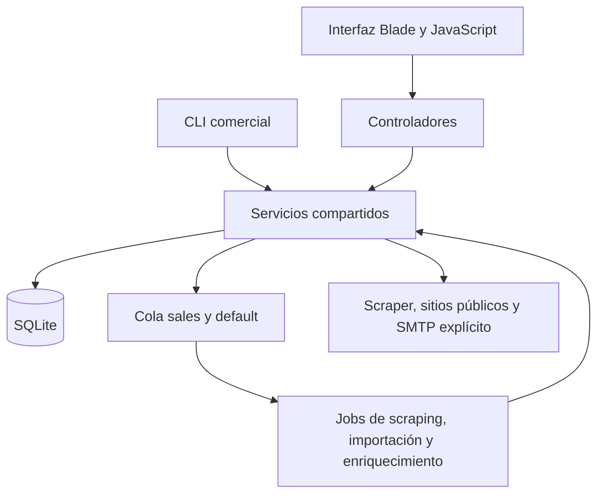

# Arquitectura

Monolito Laravel con SQLite, Blade/JavaScript y cola persistente. El [modelo de datos](DATA_MODEL.md) define relaciones; [Operación](OPERATIONS.md) describe cómo ejecutar y recuperar el sistema. El estado de una instalación y la evidencia de pruebas se registran en [Estado](PROJECT_STATE.md).

## Componentes y límites

| Área | Componentes principales | Responsabilidad |
| --- | --- | --- |
| Cartera y contactos | [CrmController](../app/Http/Controllers/CrmController.php), [LeadContactSynchronizer](../app/Services/LeadContactSynchronizer.php) | Contactos asociados, proyección del principal, servicios y renovaciones. |
| Identidad | [ContactNormalizer](../app/Services/ContactNormalizer.php), [LeadIdentityMatcher](../app/Services/LeadIdentityMatcher.php) | Normalización, coincidencia confiable, ambigüedad y contradicciones. |
| Adquisición | [GoogleMapsScraperService](../app/Services/GoogleMapsScraperService.php), [LeadImporter](../app/Services/LeadImporter.php) | Orquestación controlada del scraper, revisión CSV y procesamiento incremental. |
| Importación puntual | [NotionImporter](../app/Services/NotionImporter.php), [NotionValueParser](../app/Services/NotionValueParser.php), [NotionNotesSanitizer](../app/Services/NotionNotesSanitizer.php) | ZIP revisado, decisiones reproducibles, datos seguros e idempotencia. |
| Evidencia | [LeadEnricher](../app/Services/LeadEnricher.php) y colaboradores | Fuentes acotadas, extracción, conciliación y actualización transaccional. |
| Puntuación | [LeadScorer](../app/Services/LeadScorer.php), [OfferMatcher](../app/Services/OfferMatcher.php), [ScoreSnapshotService](../app/Services/ScoreSnapshotService.php) | Cálculo por oferta, recomendación y conocimiento al contactar. |
| Oportunidades | [CampaignMembership](../app/Services/CampaignMembership.php), [LeadPipeline](../app/Services/LeadPipeline.php) | Oferta, estado y próxima acción de cada prospecto/campaña. |
| Contacto | [ContactWorkflow](../app/Services/ContactWorkflow.php), [EmailContactService](../app/Services/EmailContactService.php), [WhatsAppMessageService](../app/Services/WhatsAppMessageService.php) | Registro manual, SMTP explícito, preparación de mensajes y snapshots. |
| Trabajo y medición | [CommercialWorkService](../app/Services/CommercialWorkService.php), [ExperimentService](../app/Services/ExperimentService.php), [MetricsService](../app/Services/MetricsService.php) | Pendientes, atribución de variantes y resultados contextualizados. |
| Consultas y exportación | [LeadFilterService](../app/Services/LeadFilterService.php), [ExportService](../app/Services/ExportService.php), [CsvSerializer](../app/Services/CsvSerializer.php) | Selección común para web/CLI/export y serialización segura. |
| Consolidación y recuperación | [LeadMergeService](../app/Services/LeadMergeService.php), [BackupService](../app/Services/BackupService.php) | Decisiones revisadas, originales archivados, respaldo e integridad. |

La aplicación no requiere Redis, microservicios ni APIs de IA. El Bridge existente intercambia prompts/JSON de forma manual; las sugerencias quedan pendientes de revisión. No incluye multiusuario ni autenticación para exponer el servicio fuera del entorno local.

## Fuentes de verdad

- `Lead` conserva identidad y campos de contacto principales. `LeadContactSynchronizer` sincroniza el contacto principal en la misma transacción; añadir otra persona no cambia esa proyección.
- `campaign_lead` representa la oportunidad: oferta seleccionada, estado, fechas y permiso de contacto. `Lead.status` conserva compatibilidad y el contexto sin campaña.
- `LeadSource` identifica procedencia. Una importación no crea oportunidades, cierres o contactos realizados que no ocurrieron.
- `Signal` representa evidencia con fuente, revisión y vigencia. Los agregados de `Lead.signals` no sustituyen la explicación de cada observación.
- `LeadOfferScore` conserva el cálculo actual por oferta. `ContactAttempt.score_snapshot` conserva el conocimiento al contactar y no se actualiza después.
- Intentos realizados y eventos posteriores justifican métricas. Contadores heredados y estados globales actuales no sustituyen esa atribución.

## Adquisición e importación

El scraper recibe una consulta de campaña, produce un CSV y delega su importación. [ExecuteScrapeRun](../app/Jobs/ExecuteScrapeRun.php) y [ImportLeadFile](../app/Jobs/ImportLeadFile.php) distinguen reservas ocupadas de resultados terminales. Cada reserva tiene propietario, token y caducidad; solo su propietario escribe checkpoints o libera trabajo. Una reserva activa se reprograma, sin declarar éxito ni consumir reintentos como un fallo terminal.

`LeadImporter` comparte parser, mapeo, validación y normalización con el análisis previo. Conserva hash del archivo, filas procesadas y contadores. El reintento reutiliza CSV válido y continúa desde su checkpoint; el scraper solo termina cuando concluye la importación. Los errores persistidos contienen fila/campo/motivo, sin copiar toda la fila.

`LeadIdentityMatcher` distingue identidad confiable y candidatos ambiguos frente a contradicciones de identificador, nombre y ubicación. Compartir dominio/email/teléfono no basta para fusionar sucursales. Los posibles duplicados del scraper se conservan con trazabilidad y quedan bloqueados para contacto hasta revisión. El importador de Notion deja pendientes las decisiones ambiguas.

## Importación de Notion

El importador lee el ZIP sin extraerlo al disco, limita tamaño/archivos y rechaza rutas o formatos inseguros. Selecciona un CSV principal y correlaciona fichas Markdown por identificadores o propiedades inequívocas. Las notas con posibles credenciales se omiten completas de forma conservadora; no se guardan versiones sin depurar.

La vista previa conserva huellas de entradas, decisiones, zona horaria y estado de cartera/contactos/servicios/procedencias. Una aplicación desactualizada se rechaza. El comando requiere revisión aprobada, ausencia de trabajo activo, respaldo verificable y transacción. La clave de procedencia evita duplicar identidades, contactos o notas. Los datos de otra persona no completan los canales de un principal distinto.

Los procedimientos y el formato de decisiones pertenecen a [Operación](OPERATIONS.md#importación-de-notion), no a este documento.

## Enriquecimiento y puntuación

[EnrichLead](../app/Jobs/EnrichLead.php) evita solapamientos por prospecto. `LeadEnricher` coordina presupuesto, robots, descubrimiento interno, extracción DOM/JSON-LD, conciliación de identidad y reconciliación de evidencia. La escritura de observaciones y estados de fuente es transaccional. Las fuentes secundarias aportan evidencia sin reemplazar automáticamente identidad principal.

`PublicWebsiteFetcher` valida todas las A/AAAA públicas y fija la IP aprobada en cURL, conservando hostname y TLS. Solo acepta HTTP/HTTPS y puertos 80/443; desactiva proxies y redirecciones y limita el cuerpo antes de cargarlo. Proxy/redirecciones se configuran mediante las opciones de alto nivel del cliente HTTP; `CURLOPT_RESOLVE` mantiene la fijación DNS. Un error técnico queda como desconocido.

`LeadScorer` conserva compatibilidad global y calcula ofertas activas o elegidas explícitamente. `OfferMatcher` recomienda sin reemplazar la oferta de campaña. Duplicados, exclusiones y habilitación de clientes siguen siendo controles independientes de la puntuación. Las reglas, fuentes y presupuestos completos están en [Enriquecimiento](ENRICHMENT.md) y [Scoring](SCORING.md).

## Contacto y resultados

`ContactWorkflow` registra lo realizado en el contexto de campaña, captura la puntuación y planifica el siguiente paso. `EmailContactService` reserva el intento y captura antes de SMTP; un envío fallido no entra en la muestra de enviados. WhatsApp solo prepara una URL y un mensaje editable: abrirlo no registra envío.

`LeadPipeline` conserva transacción e historial por campaña y pausa seguimientos cuando corresponde. Ganar una oportunidad establece la relación de cliente, sin crear servicios ni pagos. `ExperimentService` mantiene asignación estable entre variantes menos utilizadas y atribuye solo contenido compatible realmente registrado. No garantiza aleatoriedad ni elige un ganador.

Las métricas históricas usan snapshots, contexto y eventos posteriores atribuibles. La exploración del score actual se mantiene separada. No se usan resultados CRM como predictores del éxito que luego se mide. [Scoring](SCORING.md#métricas-históricas) detalla cohortes y límites.

## Consultas, rendimiento y exportación

`LeadFilterService` separa selección y carga de relaciones. Cada pantalla pide las relaciones necesarias; el workspace calcula datos por pestaña. Las mismas selecciones se usan en acciones, CLI y exportaciones. IDs explícitos vacíos o inválidos no amplían la consulta.

Los filtros y orden por puntuación usan el contexto de oferta y cálculos vigentes; un cálculo desconocido no se sustituye por el global si existe oferta. El analítico conserva una fila por oportunidad y su atribución de respuesta. CSV procesa lotes y comparte neutralización de fórmulas; JSON materializa la selección por compatibilidad.

`sales:inspect` no dispara consultas externas ni recalcula. Los recursos, filtros y ejemplos se documentan una sola vez en [CLI comercial](OPERATIONS.md#cli-comercial). Los presupuestos de red no sustituyen mediciones de carga real; las mediciones sintéticas y sus límites están en Estado y el archivo de entregas.

## Consolidación y recuperación

`LeadMergeService` requiere principal, decisiones completas y una huella de revisión vigente. Verifica respaldo y registra originales, decisiones y hash antes de trasladar relaciones en una transacción. Una revisión desactualizada, ambigua o con tareas incompatibles se rechaza. Los snapshots conservan su identidad original; la atribución de una ficha absorbida exige el vínculo archivado hacia la principal.

`BackupService` verifica integridad, claves foráneas, estructura y migraciones. Las copias de versiones distintas requieren recuperación ensayada, no un bypass del control. [Operación](OPERATIONS.md#respaldos-y-recuperación) contiene el procedimiento autorizado y la protección de datos.

## Verificación y mantenimiento

Los tests aíslan SQLite, almacenamiento, vistas, logs, caché y transportes desde [TestCase](../tests/TestCase.php) y [phpunit.xml](../phpunit.xml). HTTP inesperado se bloquea; el scraper y el correo se simulan. La compatibilidad del transporte cURL se comprueba inicializando un handle sin ejecutar una conexión.

Consulta [las reglas de documentación](README.md#mantener-la-documentación) antes de añadir otro resumen de una entrega a la arquitectura. Las decisiones y resultados históricos permanecen en el [archivo](archive/README.md).
