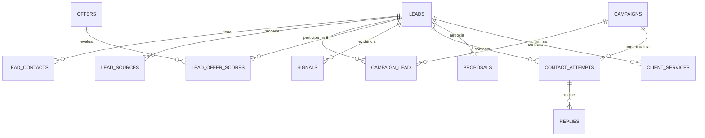

# Modelo de datos

Referencia del esquema y sus invariantes actuales. Las [migraciones](../database/migrations) y [modelos](../app/Models) definen los tipos, índices y relaciones exactos. Este documento agrupa los campos por responsabilidad; no sustituye el esquema ni un historial de migraciones. Los cambios de versión están en [Changelog](CHANGELOG.md).

## Relaciones principales

El diagrama resume las relaciones de negocio; algunas referencias de respuesta, propuesta y servicio son opcionales. La oferta sugerida del registro, la oferta de campaña y la oferta capturada en un contacto tienen responsabilidades diferentes.

## Cartera

### `leads` — Lead

| Grupo | Campos relevantes |
| --- | --- |
| Identidad | `name`, `entity_type`, `category`, `segment`, `location`, `city`, `country`, `language`, `website_url`, `domain`. |
| Contacto principal | `email`, `phone`, `phone_original`, `contact_person`, `contact_role`. |
| Procedencia compatible | `source`, `source_identifier`, `acquired_at`; el detalle está en `lead_sources`. |
| Relación | `is_customer`, `is_collaborator`, `relationship_type`, `classification_pending`, `tags`, `notes`. |
| Organización manual | `manual_priority`, `next_action_at`, `estimated_value_minor`, `estimated_currency`. |
| Fechas declaradas | `origin_created_at`, `imported_last_contact_at`, `delivery_due_at`. |
| Compatibilidad comercial | `status`, `suggested_offer_id`, `offer_match_reason`, `score_total`, `data_quality_score`, `contactability_score`, `offer_fit_score`, `data_quality`. |
| Resumen enriquecido | `signals`, `social_urls`, `contact_methods`, `primary_cta`, `booking_visible`, `enriched_at`. |
| Restricciones | `excluded_at`, `exclusion_reason`, `duplicate_status`, `duplicate_rule`, `possible_duplicate_of_lead_id`. |

`entity_type` distingue persona y organización. Cliente y colaborador son indicadores independientes; `relationship_type` conserva una proyección compatible. La prioridad manual no es puntuación. Las fechas importadas no generan contactos o eventos históricos ficticios.

Estados del pipeline definidos por [Lead::STATUSES](../app/Models/Lead.php): `NEW`, `ENRICHED`, `QUALIFIED`, `QUEUED`, `CONTACTED`, `REPLIED`, `INTERESTED`, `PROPOSAL`, `NEGOTIATION`, `WON`, `LOST`, `PAUSED`. En campaña prevalece el estado de `campaign_lead`; el global conserva compatibilidad y el caso sin campaña.

### `lead_contacts` — LeadContact

Campos: `lead_id`, `name`, `role`, `phone`, `phone_original`, `email`, `is_primary`, `import_key`, timestamps. La pareja `lead_id/import_key` es única. El servicio de sincronización mantiene un principal por organización y actualiza su proyección junto con `Lead` en la misma transacción; esa garantía no es un índice único de `is_primary`.

Añadir otra persona no completa los canales de un principal distinto. Eliminar un asociado conserva los campos principales de la ficha. Una persona independiente utiliza sus propios datos de `Lead`.

### `client_services` — ClientService

Campos: `lead_id`, `proposal_id` opcional, `name`, `type`, `status`, `amount_minor`, `currency`, `starts_on`, `ends_on`, `renews_on`, `reference_url`, `notes`, timestamps. La propuesta vinculada debe pertenecer al mismo cliente.

Tipos: `web`, `hosting`, `maintenance`, `ecommerce`, `automation`, `other`. Estados de ejecución: `planned`, `active`, `paused`, `completed`, `cancelled`. Un cliente admite varios servicios. Su ejecución y renovación no mueven el pipeline por sí solas.

Los importes de servicios y valores estimados usan unidades menores enteras y moneda; `NULL` es desconocido y cero es conocido. No representan cobros. `proposals.amount` conserva su importe decimal propio.

## Ofertas y oportunidades

### `offers` — Offer

Campos: `name`, `target_customer`, `segment`, `pains`, `benefits`, `compatibility_signals`, `assets`, `demo_url`, `portfolio_url`, `suggested_cta`, `active`, `rules`, timestamps. `rules` conserva configuración de compatibilidad, mínimo y perfil explícito `scoring_profile` cuando existe. Las reglas numéricas persistidas pertenecen a `scoring_rules`.

### `campaigns` — Campaign

Campos: `offer_id`, `name`, `segment`, `country`, `city`, `language`, `source`, `channel`, `mode`, `cta`, `starts_at`, `ends_at`, `daily_limit`, `scrape_limit`, `dry_run`, `kill_switch`, `status`, `follow_up_1_delay_days`, `follow_up_2_delay_days`, `contact_window_start`, `contact_window_end`, timestamps.

Una campaña organiza oportunidades y tareas; no equivale a una identidad. Las restricciones de contacto permanecen independientes de la recomendación de oferta y puntuación.

### `campaign_lead` — oportunidad

Campos: `id`, `campaign_id`, `lead_id`, `offer_id`, `status`, `next_action_at`, `interested_at`, `won_at`, `lost_at`, `contact_enabled`, timestamps. La pareja campaña/prospecto es única. El pivot es la fuente de estado, oferta y fechas en contexto de campaña.

`contact_enabled` no habilita automáticamente clientes importados. La vinculación o habilitación explícita permite trabajar esa oportunidad; no crea un contacto realizado. El pipeline global representa cada oportunidad separada.

### `lead_status_histories`

Campos: `lead_id`, `campaign_id` opcional, `from_status`, `to_status`, `reason`, `changed_at`, timestamps. Conserva cambios de estado y su contexto. Una fecha declarada de Notion o edición de la clasificación de cartera no se transforma en un cierre comercial histórico.

## Adquisición y procedencia

### `campaign_queries` y `scrape_runs`

`campaign_queries`: `campaign_id`, `query`, `location`, `result_limit`, `status`, timestamps.

`scrape_runs`: contexto de campaña/consulta, `source`, `query`, `location`, `result_limit`, `status`, `dry_run`, `timeout_seconds`, `output_file`, `command`, `arguments`, `exit_code`, `stdout`, `stderr`, contadores `raw_count/imported_count/duplicate_count/error_count`, `started_at`, `finished_at`, `heartbeat_at`, `cancel_requested_at`, `attempts`, `phase`, `claimed_at`, `claim_token`, timestamps.

Fase y estado se conservan aunque el proceso se interrumpa. El token identifica al propietario autorizado; ocupado no equivale a completado. La importación vinculada determina cuándo puede finalizar la adquisición.

### `import_runs` y `import_row_issues`

`import_runs`: `campaign_id` opcional, `campaign_query_id`, `scrape_run_id`, `source`, `query`, `segment`, `location`, `file_path`, `file_hash`, `raw_metadata`, `mapping`, `status`, `error_message`, `processed_rows`, `claim_token`, `claimed_at`, contadores de crudos/importados/duplicados/posibles/excluidos/errores, fechas y timestamps.

`import_row_issues`: `import_run_id`, `row_number`, `errors` JSON y timestamps, con pareja importación/fila única. El diagnóstico persistido no copia toda la fila. El archivo privado descargable relee el original y contiene sus celdas.

### `lead_sources` — LeadSource

Campos: `lead_id`, `import_run_id` opcional, `source`, `source_identifier`, `source_url`, `query`, `observed_at`, `import_key`, `metadata`, timestamps. `import_key` es único cuando está presente. Metadata conserva datos depurados de procedencia, advertencias y coordenadas públicas válidas cuando existen.

Para Notion se conserva la identidad de origen, clasificación reconocida y huellas de notas seguras; no se guardan credenciales o versiones originales sin depurar. Sus importaciones usan `campaign_id=NULL` y no fabrican oportunidades, servicios ni eventos comerciales. La idempotencia depende de esa procedencia.

La deduplicación considera identificadores, nombre/ubicación y canales comparables. Un recurso compartido sin corroboración queda pendiente. Teléfonos de texto, ceros o longitud no comparable se conservan para revisión, sin usarlos como identidad. Las reglas de conciliación web están en [Enriquecimiento](ENRICHMENT.md).

## Evidencia y puntuación

### `signals` — Signal

Campos: `lead_id`, `type`, `value`, `evidence`, `detected_at`, `source`, `evidence_kind`, `review_status`, `evidence_url`, `source_reference`, `extraction_method`, `confidence`, `expires_at`, `rule_version`, `metadata`, `evidence_key`, `is_current`, timestamps.

- `evidence_kind`: `observed`, `inferred`, `unknown`, `conflict`.
- `review_status`: `confirmed`, `pending`, `rejected`.
- `confidence`: indicador entre 0 y 1; no es probabilidad de compra.
- `current()`: observación marcada vigente y no vencida.

Hay índices por prospecto/clave y prospecto/vigencia, sin unicidad de clave que impida conservar historia o reconciliar fusiones. La clave lógica agrupa fuente/referencia/tipo; metadata puede conservar valores normalizados e historial acotado. El HTML completo no se persiste.

Las revisiones manuales conservan método `human_review`. Una inferencia confirmada sigue siendo una inferencia. `no_website` o un fallo de transporte desconocidos no generan una necesidad; observar una página HTTP no prueba ausencia de HTTPS.

### Estados de enriquecimiento

`enrichment_source_states`: `lead_id`, `source`, `input_sha256`, `last_checked_at`, `next_check_at`, `result`. La pareja prospecto/fuente es única y permite actualización incremental.

`enrichment_request_states`: `key` hash, `last_started_at`, `lease_until`, `lease_token`, `expires_at`, `payload`. Conserva reserva/frecuencia por host y políticas robots en caché; no es una relación comercial ni contiene páginas completas.

### `scoring_rules`, `score_components`, `lead_offer_scores`

`scoring_rules`: `component`, `weight`, `points`, `active`, `description`, `offer_id` opcional, `dimension`, timestamps. Las reglas por oferta especializan las globales.

`score_components`: `lead_id`, `component`, `weight`, `value`, `points`, `evidence`, timestamps. Conserva explicación compatible del cálculo global de la ficha.

`lead_offer_scores`: `lead_id`, `offer_id`, `total`, `dimensions`, `explanation`, `confidence`, `coverage`, `rule_version`, `calculated_at`, timestamps. La pareja prospecto/oferta es única; existe índice por oferta/total. Representa el cálculo actual y se invalida si cambian sus entradas relevantes o caduca evidencia. No es el historial al contacto.

Dimensiones: adecuación, necesidad, contactabilidad y evidencia. Pesos, perfiles, versiones y exclusión de resultados CRM están documentados en [Scoring](SCORING.md).

## Contactos, respuestas y propuestas

### `message_templates`

Campos: `offer_id` opcional, `name`, `language`, `channel`, `segment`, `stage`, `subject`, `body`, `active`, timestamps. Canal, idioma, paso y oferta deben ser compatibles con el contacto. Las variables se renderizan y los datos faltantes impiden un envío incompleto.

### `contact_attempts` — ContactAttempt

Campos: `lead_id`, `campaign_id`, `offer_id`, `variant`, `experiment_variant_id`, `message_template_id`, `channel`, `step`, `planned_at`, `due_at`, `performed_at`, `status`, `manual_intervention`, `dry_run`, `subject`, `message_snapshot`, `result`, `preparation_seconds`, `score_snapshot`, timestamps.

Pasos: `initial`, `follow_up_1`, `follow_up_2`. Una oportunidad no admite secuencias activas duplicadas según los controles del flujo. Un intento planificado o una simulación no son contacto realizado. Para muestras de enviados se requiere estado `sent`, `dry_run=false` y fecha de realización.

`score_snapshot` es JSON nullable e inmutable una vez capturado. Incluye identidad/contexto originales, oferta/oportunidad, total/dimensiones, confianza/cobertura, explicación y evidencia utilizada, versión y fechas. Desconocido conserva su motivo, sin reconstrucción futura. El envío SMTP captura antes de conocer el resultado; un fallo conserva auditoría pero no cuenta como enviado.

### `replies` — Reply

Campos: `lead_id`, `campaign_id` opcional, `contact_attempt_id` opcional, `category`, `body`, `received_at`, `requires_human`, `objection_type`, `objection_notes`, timestamps. La vinculación a un intento fundamenta atribución de canal y variante. El silencio no genera una respuesta ficticia. Registros sin contexto suficiente se conservan sin atribución arbitraria.

### `proposals` — Proposal

Campos: `lead_id`, `campaign_id` opcional, `offer_id` opcional, `group_key`, `service`, `amount`, `currency`, `version`, `sent_at`, `response`, `objections`, `modifications`, `result`, timestamps. Las versiones se agrupan mediante `group_key`. El importe decimal no equivale a ingreso cobrado y una propuesta no crea automáticamente un servicio.

## Experimentos y sugerencias

`experiments`: campaña, nombre, variable, estado y fechas. `experiment_variants`: experimento, plantilla opcional, nombre, contenido y contadores heredados. `lead_experiment_variant`: prospecto, variante y fecha de asignación.

La asignación estable usa variantes menos utilizadas. Las pantallas calculan muestras desde intentos reales, no desde contadores heredados. `contact_attempts.experiment_variant_id` identifica la variante utilizada y `variant` conserva el nombre como snapshot. El mensaje editado no recibe atribución automática al contenido original. No hay ganador automático.

`llm_bridge_runs` conserva caso de uso, estado, prompt, IDs y JSON/errores de validación. `llm_suggestions` conserva run, prospecto, tipo, payload y estado. Las sugerencias manuales no se incorporan como hechos comerciales sin revisión ni disparan llamadas automáticas a una API.

## Consolidación y tablas auxiliares

`lead_merges`: `source_lead_id` único sin FK a la ficha absorbida, `target_lead_id` con borrado restringido, `plan_sha256`, `original_records`, `decisions`, `backup_path`, `backup_sha256`, timestamps. Conserva originales, decisiones y respaldo; las relaciones resultantes siguen la revisión aprobada. Los snapshots no se reescriben y las métricas reconocen un origen absorbido solo mediante ese vínculo archivado.

`exclusions` conserva tipo/valor/motivo normalizados. `saved_lead_views` guarda nombre, ámbito y filtros. `application_preferences` conserva preferencias clave/valor. `system_logs` almacena diagnóstico depurado. Las tablas de jobs, caché, sesiones y migraciones pertenecen al soporte Laravel; no representan actividad comercial.

## Exportaciones y conservación

CSV y JSON incluyen entidades y relaciones seleccionadas mediante los filtros compartidos. El analítico representa una fila por oportunidad, o por registro sin campaña, y añade intento/canal/variante de respuesta. SQLite conserva un snapshot completo compatible con su versión de esquema.

Una copia con claves foráneas rotas se rechaza. La exportación no permite inferir actividad inexistente ni convierte fechas importadas en eventos. [Operación](OPERATIONS.md#protección-de-datos-y-retención) detalla privacidad, respaldo y recuperación.
